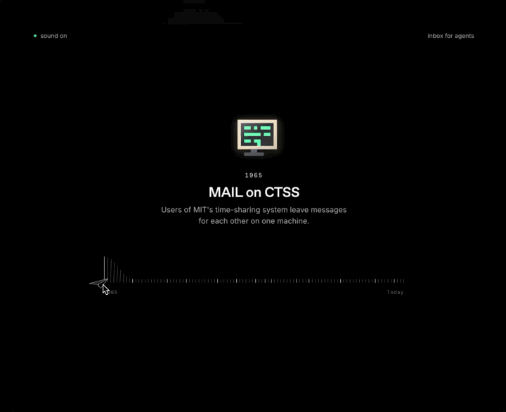

# History of Mail

Sixty years of email on one line. Move the cursor to scrub from the first messages on a shared computer in 1965 to agents reading the inbox today. Lives at [historyofmail.org](https://historyofmail.org).



[Watch the video](media/demo.mp4)

## How it works

- The ruler is a row of thin ticks. The ones under the cursor swell into a bump and lean outward, driven by per tick CSS transitions so fast scrubbing never stutters
- The cursor is a paper plane that banks with your scrub speed
- Each moment has a pixel sprite drawn as a character grid and rendered as SVG, with a glow in its own colors, a gloss highlight and a shadow
- Moments crossfade with a blur and slide in from the direction you are scrubbing
- Every tick plays a card flip synthesized in Web Audio, heavier on the moments themselves
- Arrow keys step between moments. Touch drags the ruler directly

## Develop

```sh
pnpm install
pnpm dev
```

## Structure

- `components/scene.tsx`: the whole page. The plane cursor, the current moment and the ruler
- `components/moments.ts`: the moments on the line. Edit this to change the content
- `components/illustrations.tsx`: one pixel sprite per moment, as a grid of palette letters
- `components/use-ruler-sound.ts`: the card flip sound
